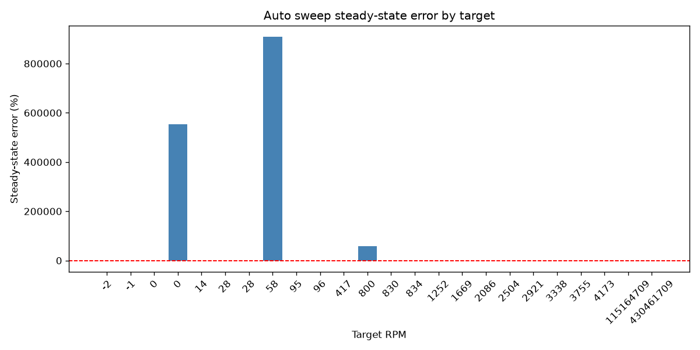
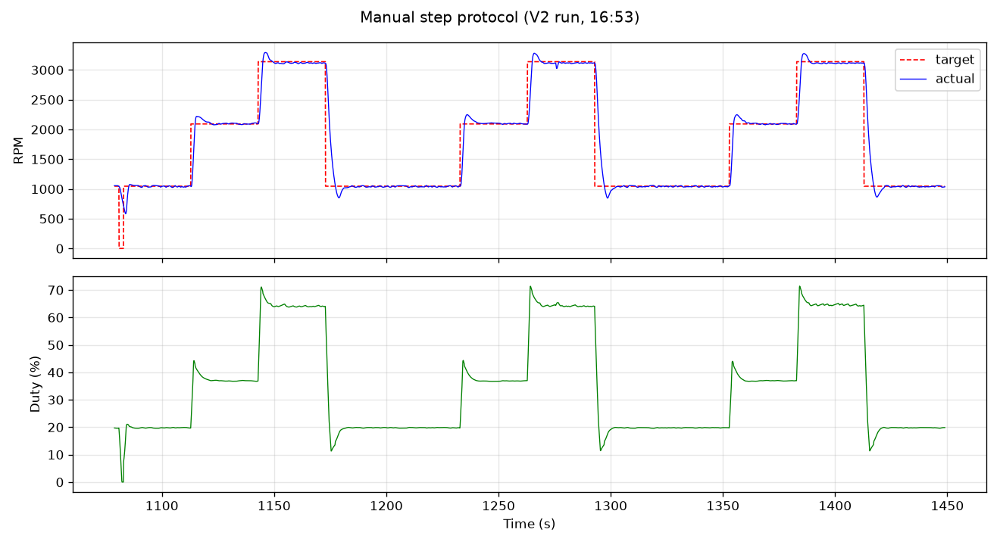
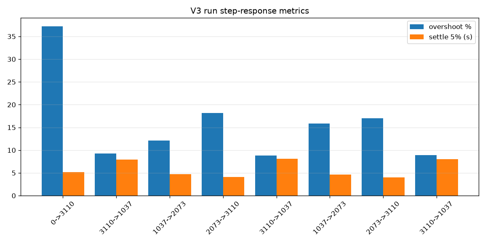
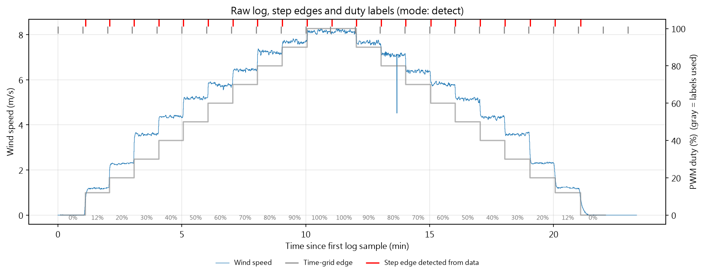
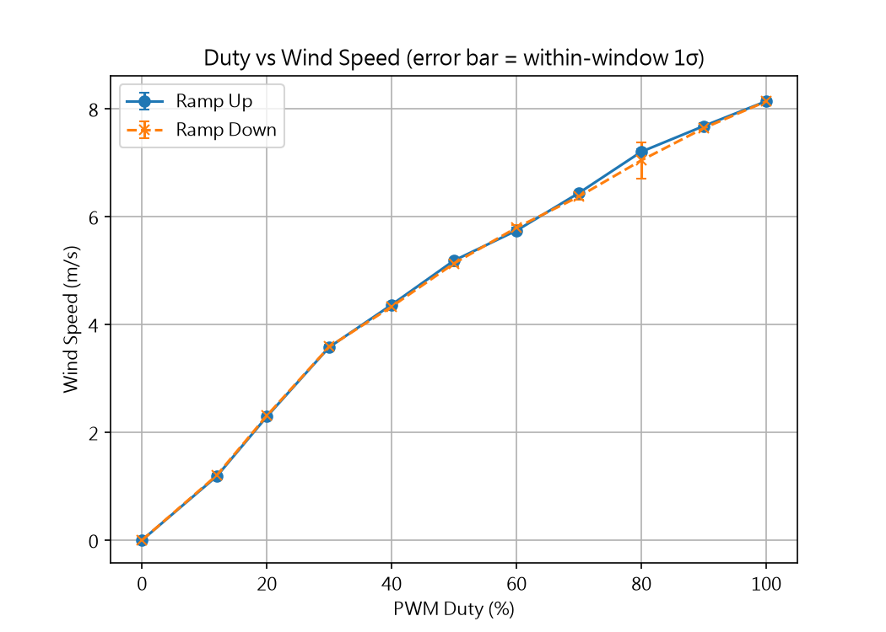
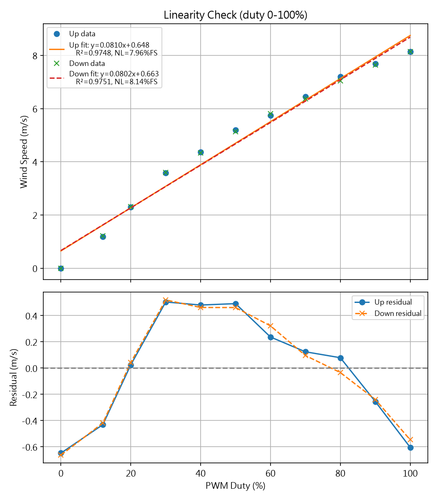
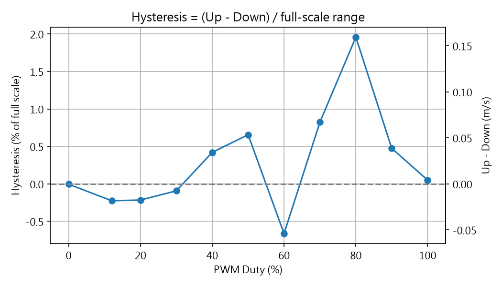
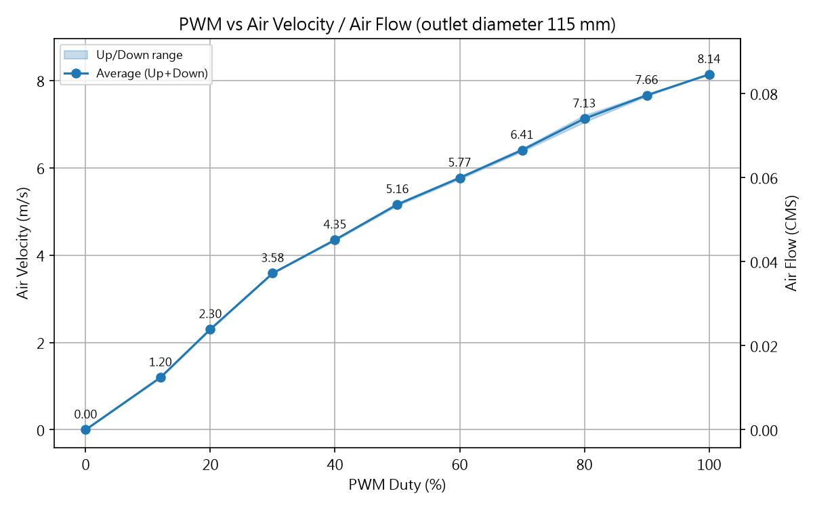
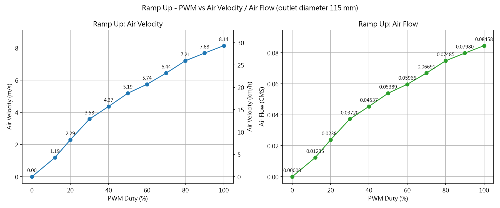
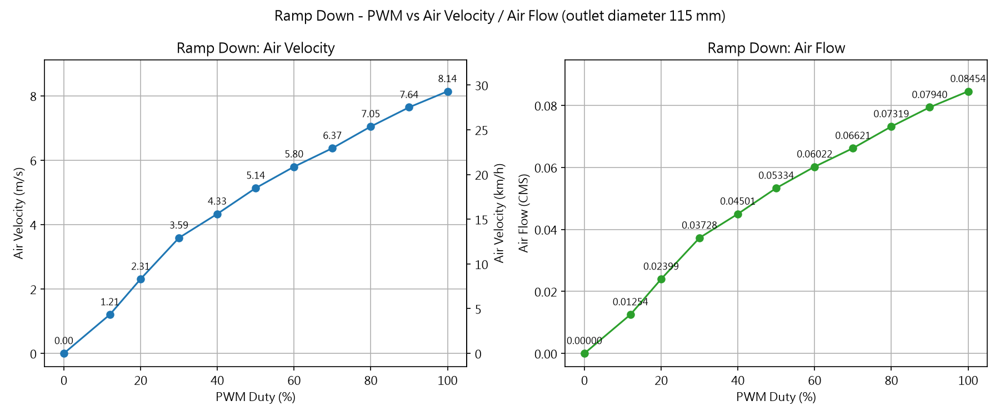

# FANPWM 專案報告（標題 / 子標題 / 說明 / 圖表數據佐證）

本文件是整體總整理的升级版本，包含流程、方法、進度，且有圖表與數據佐證。

---

## 1. 專案目標
### 1.1 主目標
- 建立 STM32G4 風扇的 PWM / RPM / 風速关系。
- 完成閉迴路 RPM 控制驗證。
- 量化 target、actual、duty、ff、integral、ripple。

### 1.2 副目標
- 建立可重現測試流程。
- 將韌體、資料、腳本與報告版控。
- 建立 auto/manual 切換與可追蹤分析 pipeline。

### 1.3 佐證
- Auto sweep steady-state 有完整 per-target summary（见 第 7 節）
- Manual step metrics 已 repeatedly measured（Run1 / Run2 / Run3）

---

## 2. 系統流程
### 2.1 初始化
- HAL_Init / SystemClock / peripherals
- TIM1 / TIM8 / TIM2 / GPIO
- `fan_control_init()`
- `rpm_ctrl_init()`
- `rpm_sweep_init()`
- `button_ui_init()`

### 2.2 主迴圈
- `rpm_ctrl_update()`
- `rpm_sweep_update()`
- `rpm_ctrl_uart_poll()`
- `button_ui_poll()`
- CSV / status periodic logging

### 2.3 Method B 模式切換
- `A0`：stop auto sweep，進入 manual UART mode
- `A1`：enable auto sweep
- `A`：toggle

佐證：`logs/clean/*.csv` 可 separated 觀察 target transitions from `0 → 1038 → 2073 → 3110` and step durations.

---

## 3. 控制方法
### 3.1 Feedback Control
- target from UART: `R<rpm>` or `P<pct>`
- actual RPM from tach
- PI correction plus FF from calibrated table
- target ramp, filtering, and anti-windup

### 3.2 Parameter evolution
| Version | KP | KI | I_LIMIT | ALPHA | RAMP | DEADBAND |
|---|---:|---:|---:|---:|---:|---:|
| V1 | 0.20 | 0.70 | 10.0 | 0.35 | 1000 | 0.5% |
| V2 | 0.18 | 0.45 | 6.0 | 0.45 | 800 | 0.5% |
| V3 | 0.18 | 0.45 | 6.0 | 0.45 | 700 | 0.5% |

### 3.3 Sweep Characterization
- 0 → 10 → … → 100 → … → 10
- base dwell 30s, 100% dwell 60s
- closed-loop rpm sweep 用于 steady-state

佐證：auto sweep CSV around 11 mins and per-dwell steady state table.

---

## 4. 量測與分析流程
### 4.1 Raw Capture
- serial port
- MCU CSV line format
- raw log into `logs/*.csv`

### 4.2 Clean / Validate
- filter malformed numeric lines
- remove range-invalid rows
- normalize 10 MCU CSV columns
- reorder by tick

### 4.3 Derived Outputs
- sweep steady-state summary
- step response metrics
- PI candidate generation

### 4.4 Scripts
- `send_step_protocol.py`
- `analyze_rpm_test.py`
- `estimate_pi_from_steps.py`

### 4.5 佐證：clean data quality
最新 Run3 `COM4_20261101_170801.step.csv`：
- numeric rows: 3032
- valid rows: 3032
- skipped malformed: 0
- rejected range: 0

---

## 5. 測試協議
### 5.1 固定 protocol
1. `A0`
2. `P25` hold 30s
3. `P50` hold 30s
4. `P75` hold 30s
5. `P25` hold 30s
6. repeat 3 times

佐證：protocol config and `send_step_protocol.py` implementation.

### 5.2 評估接受準則
- Steady-state error：`±5%`
- Overshoot：`<15%`
- Settling time：`<2s`
- 3-repeat CV：`<10%`
- RPM ripple minimal

佐證：report tables in `TEST_RESULTS.md` append with each run.

---

## 6. Auto Sweep 穩態數據
### 6.1 说明
Sweep 用于 characterization，每次 target dwell 30s（100% 60s），per target takes last stable portion to compare error and ripple.

### 6.2 資料表
| target RPM | stable RPM | ripple std | duty mean | err % |
|---:|---:|---:|---:|---:|
| 0.0 | 0.0 | 0.0 | 0.23 | 0.00 |
| 417.3 | 450.1 | 53.3 | 11.04 | +7.86 |
| 834.5 | 853.0 | 8.9 | 16.95 | +2.22 |
| 1251.8 | 1245.0 | 8.2 | 22.58 | -0.55 |
| 1669.1 | 1654.3 | 12.6 | 28.68 | -0.89 |
| 2086.3 | 2091.7 | 5.2 | 36.78 | +0.26 |
| 2503.6 | 2495.1 | 4.6 | 47.05 | -0.34 |
| 2920.9 | 2921.2 | 3.6 | 57.66 | +0.01 |
| 3338.1 | 3347.4 | 4.5 | 69.06 | +0.28 |
| 3755.4 | 3748.4 | 4.9 | 80.02 | -0.19 |
| 4172.6 | 4148.5 | 7.2 | 95.75 | -0.58 |

### 6.3 佐证图表

说明：steady-state error 除了 417 RPM（+7.86%）都 pass ±5%；417 RPM 也是 ripple 最高。

---

## 7. Manual Step Response 資料
### 7.1 Baseline / Run1 / Run2
 representative metrics：

| Run | P25→P50 OV% | Ts 5% | P50→P75 OV% | Ts 5% | Steady err% |
|---|---:|---:|---:|---:|---:|
| Baseline | 22-23 | 4.5-4.8 | 21-27 | 3.4-4.3 | mostly <1 |
| V2 | 12-15 | 4.4-4.8 | 13-15 | 1.8-3.4 | ±1 |
| V3 | 12.1 | 4.7 | 17-18 | 4.0-4.1 | ±1 |

### 7.2 佐证图表

说明：target 与 actual tracked well, duty 平滑, 尤其 P25→P50 与 P50→P75 都 step 明显。

### 7.3 V3 metrics 近照

说明：V3 `P25→P50` OV 12.1% 仍 pass，但 `P50→P75` overshoot boundary and ripple elevated。

---

## 8. 已完成項目追蹤
### 8.1 Git / committed status
- Method B runtime toggle
- V2 constants
- V3 ramp iteration (已 commit)
- analysis scripts
- report and handbook
- test clean/output data

### 8.2 尚未 commit / 本地
- EWARM settings changes
- IAR generated BrowseInfo
- screenshot file

### 8.3 文件追蹤
- `docs/TEST_RESULTS.md`
- `docs/PI_TUNING_STRATEGY.md`
- `docs/HANDBOOK.md`
- `docs/USER_COMMANDS.md`
- `docs/PROJECT_SUMMARY.md`

---

## 9. 问题与根因
### 9.1 Overshoot
- P50→P75 ~13-18%
- 仅 at spec boundary
- likely Ki + feedforward transition

### 9.2 Settling
- P25→P50 ~4.4-4.8s
- spec 2s
- 说明 system second-order lag + integral re-build

### 9.3 Low RPM
- 417 RPM FF 誤差 7.86%
- tach ripple at low duty
- calibration density insufficient

### 9.4 版本策略
- 只在 hardware data after changes 才 commit firmware
- docs update after every run
- baseline (V2) preserved before new tuning

---

## 10. Next Actions
### 10.1 Immediate
- Use V2 as effective baseline
- lower Ki only: `0.45 -> 0.40`
- retain `KP=0.18`, `ALPHA=0.45`, `RAMP=800`
- run protocol 3 times

### 10.2 Measurement
- Repeat V2 and Ki-decrement
- Keep clean CSV / metrics
- Append to `TEST_RESULTS.md`

### 10.3 Low RPM / FF
- P10/P15/P20 tests
- improve FF table interpolation
- region-specific gain/deadband

### 10.4 Communication
- report test results with tables and charts
- commit only validated changes
- preserve stable git history

---

## Appendix A. PWM / RPM / Wind Analysis (from 12Start-style figures)
### A.1 配合 `12Start.py` 的資料佐證
- 本報告的 PWM/RPM/風速图應优先引用由 `12Start.py`（或 `fan_rpm_pwm_wind.py` / `fan_wind_analysis.py`）產出的測試圖表。
- 圖像本來 output 在 `data/output/fig*.png`。
- 本 section 用 **existing figures** 補強 relationship / hysteresis / linearity / ramp behavior，而不只是 tempfile charts.

### A.2 Available generated figures (12Start.py-style outputs)
- `data/output/fig0_timeseries_check.png`：時序 sanity check
- `data/output/fig1_duty_vs_windspeed.png`：duty vs wind speed
- `data/output/fig2_linearity.png`：線性度總图
- `data/output/fig2_linearity_12_100.png` / `fig2_linearity_20_90.png`：局部線性段落
- `data/output/fig3_hysteresis.png`：上升 / 下降迟滞
- `data/output/fig4_smoothness.png`：平滑度
- `data/output/fig5_repeatability.png`：重複性
- `data/output/fig6_pwm_velocity_flow.png`：PWM / 風量关系
- `data/output/fig7_environment.png`：环境记錄
- `data/output/fig8_ramp_up_velocity_flow.png`：上升 ramp 風速/風量
- `data/output/fig9_ramp_down_velocity_flow.png`：下降 ramp 風速/風量

### A.3 參考圖（12Start.py 產出參考）

### A.4 说明
- report 图表以本项目 `12Start.py` 風格產出的現有 data/output figures 為參考
- Analysis 应 ties 以下趨勢：hysteresis, linearity, repeatability, ramp up/down airflow behavior

说明：`12Start.py` 的 duty-step data 适用于 characterization; controller step trial 仍以 script-clean CSV analysis 為主。

## Recommendation Summary
- V2 is current good baseline
- V3 is not an improvement (ramp 700)
- Tuning should focus on Ki and FF
- document each hardware step
- next Ki decrement only, then compare
EOF